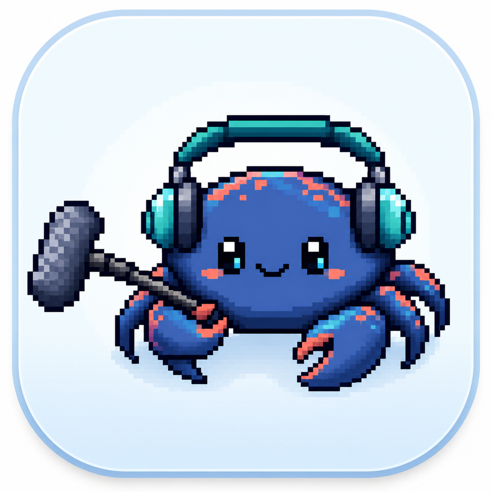

# ShoutOut

<p align="center">
  
</p>

**English dictation, right where you’re typing.**

ShoutOut is a local-first macOS dictation app. Hold **Fn/Globe**, speak, and release to paste into your current app. Double-tap for hands-free recording.

This branch contains the unreleased Mini cleanup trial. The website changes here are prepared for that update; the public app and website have not been changed.

[Website & download](https://shoutout.sh) · [Development](docs/development.md) · [Troubleshooting](TROUBLESHOOTING.md)

## A few things that make it ShoutOut

- **On your Mac.** Transcription and text cleanup run locally. No account required.
- **Less waiting.** Speech recognition starts while you talk, before you release the shortcut.
- **Light cleanup.** Optional filler removal that keeps your wording and spoken tone.
- **Easy to find again.** Searchable local transcription history with one-click copy.
- **Your spelling.** A customizable dictionary for names, acronyms, and common mishearings.
- **A little personality.** A wall-walking crab in your choice of color, or a simple Classic recording indicator.

Requires **Apple Silicon and macOS 15 or later**. Dictation downloads one **731 MB** speech model. The Mini trial includes its small cleanup model. Onboarding walks you through Microphone, Accessibility, and Input Monitoring permissions.

## Development

The app is a Swift package in [`apps/macos`](apps/macos); the website lives in [`apps/web`](apps/web).

After [setting up the build tools](docs/development.md), run from the repo root:

```sh
make run       # Build and open the app
make test      # Run Swift tests and repo checks
make web-dev   # Start the website dev server
```

See the [development guide](docs/development.md) for prerequisites, local QA, models, and release workflows.

## Dictionary

Open **Dictionary** in the app sidebar and choose **Add Entry**. Enter what ShoutOut hears under **Replace** and your preferred spelling under **Write as**. Separate multiple variations with commas or new lines. You can search, edit, delete, and test your saved entries on the same page.

Replacements match whole phrases without regard to capitalization. Longer phrases win when matches overlap. Each replacement runs once, before optional text cleanup, with every transcription engine. Mini copies the words it keeps with their spelling, case, and punctuation unchanged. Your dictionary is saved locally in `dictionary.json` alongside the app’s other local data.

## License

No open-source license is granted for the source code or project files.
